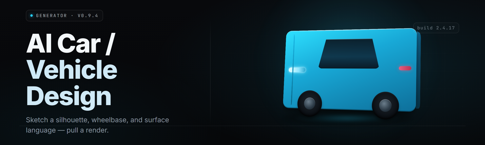

  
  
  

  

  
  

---

AI car / vehicle design generator for indie devs and modders — sketch a concept vehicle from text prompts and export mesh, spec, and livery in one pass.

## Overview

AI car / vehicle design generator for indie devs and modders — sketch a concept vehicle from text prompts and export mesh, spec, and livery in one pass.

  

## License

[MIT License](LICENSE)

  

